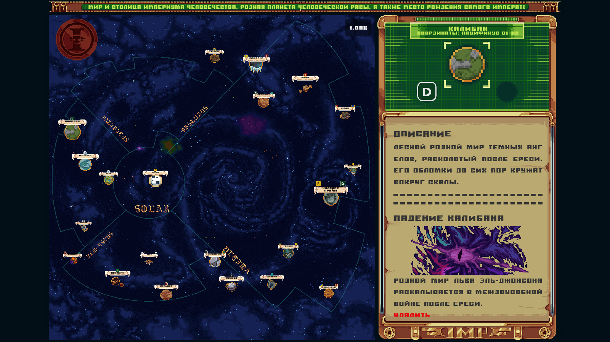
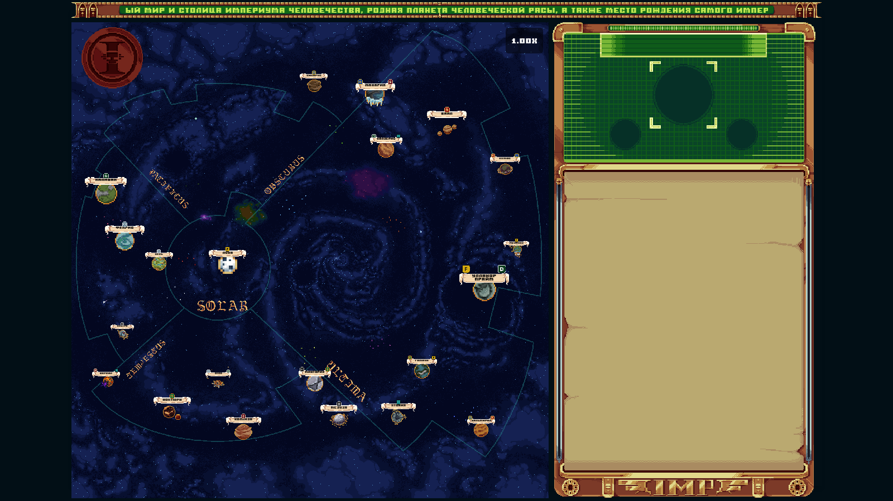
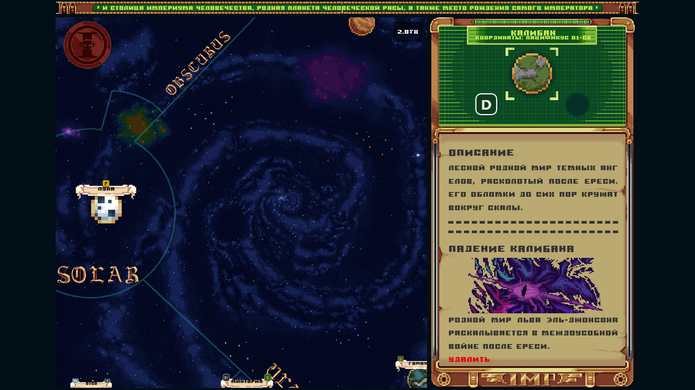
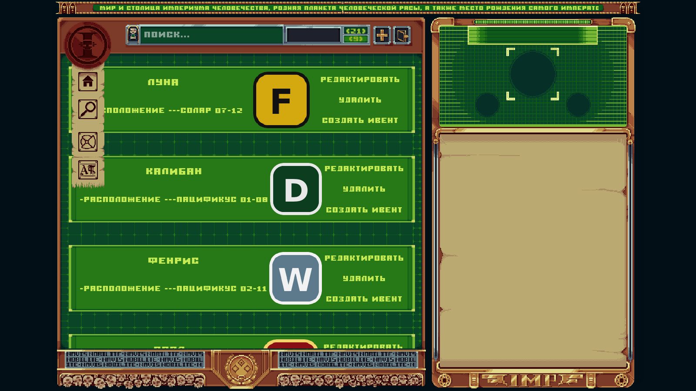
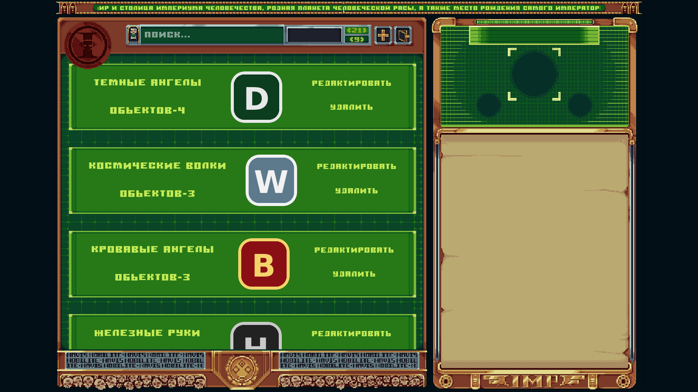
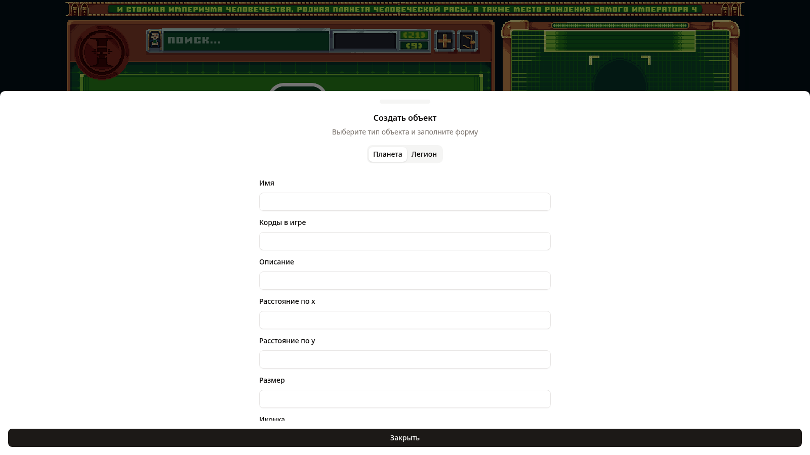
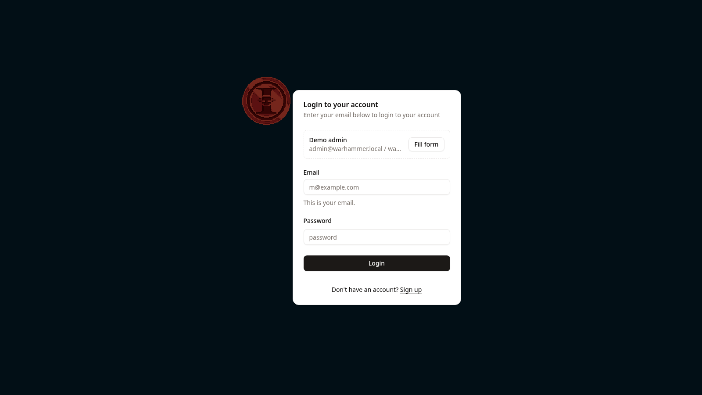
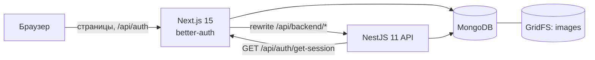

# Warhammer Map

Интерактивная карта галактики Warhammer 40k для ролевого сообщества: планеты, легионы и события на пиксель-арт карте, поиск по базе и админ-панель для редактирования всего контента без доступа к коду.




## Возможности

- **Карта** 2500x2500 с зумом колесом, перетаскиванием и границами сегментумов. Планеты, подписи и иконки легионов масштабируются вместе с картой.
- **Карточка объекта**: описание планеты, её легионы, хроника событий со скриншотами.
- **Поиск** по планетам и легионам с вкладками и счётчиками.
- **Админ-панель**: создание, редактирование и удаление планет, легионов и событий с загрузкой изображений. Доступна только пользователям с ролью `ADMIN`.
- **Авторизация** на better-auth: email и пароль, опциональное подтверждение почты через Resend, роль выдаётся по списку `ADMIN_EMAILS`.
- **Целостность данных**: двусторонние связи планета-легион и планета-событие поддерживаются сервером, отдельный скрипт `db:check` проверяет базу на висячие ссылки и потерянные файлы.

## Быстрый старт

Нужен только Docker.

```bash
git clone https://github.com/makSimka1105/warhammerMap.git
cd warhammerMap
docker compose up -d --build
docker compose run --rm seed
```

Откройте http://localhost:3000. Сид заполняет базу: 21 планета, 9 легионов, 7 событий. Ещё он создаёт демо-администратора:

| email | пароль |
|---|---|
| `admin@warhammer.local` | `warhammer40k` |

На странице входа есть кнопка, которая подставляет эти данные. Сид не трогает непустую базу. Вернуть её к исходному состоянию: `docker compose run --rm seed node dist/scripts/seed --reset` (пользователи сохраняются).

Умолчания в `docker-compose.yml` (секрет better-auth, демо-администратор, вход без подтверждения почты) рассчитаны на локальный запуск. Перед публикацией в интернет задайте свои значения в `.env`, см. раздел «Деплой».

## Скриншоты

| | |
|---|---|
|  |  |
| Карта целиком | Зум и карточка планеты с событием |
|  |  |
| Поиск по планетам, режим администратора | Поиск по легионам |
|  |  |
| Создание планеты или легиона | Вход с подсказкой демо-аккаунта |

## Архитектура



- Браузер общается только с Next. Запросы к API идут через rewrite `/api/backend/*`, поэтому они same-origin и несут cookie сессии.
- Все записи в API закрыты глобальным `AdminGuard`: он проверяет сессию через Next и пускает только роль `ADMIN` (иначе 401 или 403).
- Всё состояние лежит в одной MongoDB: коллекции планет, легионов и событий, изображения в GridFS и пользователи better-auth. Один `mongodump` переносит проект целиком (`scripts/db-export.sh`, `scripts/db-import.sh`).
- Входные данные валидируются DTO через `class-validator`. Неверный ObjectId даёт 400. Загрузки только png, jpeg и webp до 4 МБ.

## Целостность данных

Связи хранятся с обеих сторон (`planet.legions` и `legion.planets`, `planet.events` и `event.place`), поэтому сервер синхронизирует их при каждой записи:

- удаление легиона убирает его из всех планет, которые на него ссылаются, даже если массивы рассинхронизированы;
- удаление планеты удаляет её события, их скриншоты и ссылки из легионов;
- при ошибке записи только что загруженные файлы удаляются, старое изображение удаляется только после успешного сохранения;
- один и тот же легион нельзя привязать к планете дважды.

Проверка базы:

```bash
cd server && npm run build
MONGO_URL=mongodb://localhost:27017/warhammer npm run db:check
```

Скрипт проверяет 11 инвариантов: ссылки на несуществующие документы, несимметричные связи, файлы, на которые ссылаются, но которых нет в GridFS, и файлы, на которые никто не ссылается. При любой проблеме он завершается с кодом 1.

## Локальная разработка

```bash
docker compose -f docker-compose.dev.yml up -d   # MongoDB на localhost:27017

cd server
npm ci
cp .env.example .env
npm run build && npm run seed
npm run start:dev                                # API на :5000

cd ../client
npm ci
cp .env.example .env.local
npm run dev                                      # http://localhost:3000
```

После старта клиента выполните `npm run seed` в `server` ещё раз с `FRONT_URL=http://localhost:3000`, чтобы создать демо-администратора.

Проверки:

```bash
cd server && npx tsc --noEmit && npm test && npm run build   # тесты используют локальную MongoDB
cd client && npx tsc --noEmit && npm run build
```

## Переменные окружения

`server/.env`

| переменная | описание |
|---|---|
| `MONGO_URL` | обязательная, строка подключения к MongoDB |
| `FRONT_URL` | обязательная, адрес Next: CORS, проверка сессии, регистрация админа в сиде |
| `PORT` | по умолчанию `5000` |
| `SEED_ADMIN_EMAIL`, `SEED_ADMIN_PASSWORD` | демо-администратор для `npm run seed` |

`client/.env.local`

| переменная | описание |
|---|---|
| `API_ORIGIN` | адрес NestJS, подставляется при сборке |
| `MONGO_URL` | та же база, что у сервера |
| `BETTER_AUTH_SECRET` | `openssl rand -hex 32` |
| `BETTER_AUTH_URL` | публичный адрес клиента |
| `ADMIN_EMAILS` | email администраторов через `;` |
| `REQUIRE_EMAIL_VERIFICATION` | `false` отключает подтверждение почты |
| `RESEND_API_KEY`, `EMAIL_SENDER_NAME`, `EMAIL_SENDER_ADDRESS` | нужны только с подтверждением почты |
| `NEXT_PUBLIC_DEMO_EMAIL`, `NEXT_PUBLIC_DEMO_PASSWORD` | подсказка демо-аккаунта на странице входа |

Для `docker compose` все значения имеют рабочие умолчания, переопределяются через `.env` в корне (см. `.env.example`).

## API

| метод | путь | описание |
|---|---|---|
| GET, POST | `/planets` | список и создание; multipart, файл `pic`, легионы в `legion1`, `legion2` |
| GET, PUT, DELETE | `/planets/:id` | удаление каскадно удаляет события и их изображения |
| GET, POST | `/legions` | файл `icon` |
| GET, PUT, DELETE | `/legions/:id` | удаление убирает легион со всех планет |
| GET, POST | `/events` | до 4 файлов `shots`, `place` это id планеты |
| GET, PUT, DELETE | `/events/:id` | PUT меняет поля события и переносит его на другую планету, снимки не трогает |
| GET | `/files/:name` | изображение из GridFS с immutable-кэшем |

## Деплой

Бесплатная связка: MongoDB Atlas (кластер Free), API на Render (Free web service), клиент на Vercel (Hobby).

1. **Atlas**: создать кластер Free, пользователя БД, в Network Access разрешить `0.0.0.0/0`. Скопировать строку подключения, добавив имя базы: `mongodb+srv://.../warhammer`.
2. **Render**: New, Blueprint, выбрать репозиторий. `render.yaml` создаст сервис `warhammer-api`. Заполнить `MONGO_URL` и `FRONT_URL` (адрес Vercel из шага 3, его можно дописать после).
3. **Vercel**: импортировать репозиторий, Root Directory `client`. Переменные: `API_ORIGIN` (адрес Render), `MONGO_URL`, `BETTER_AUTH_SECRET`, `BETTER_AUTH_URL` (адрес Vercel), `ADMIN_EMAILS`, `REQUIRE_EMAIL_VERIFICATION=false`, по желанию `NEXT_PUBLIC_DEMO_EMAIL` и `NEXT_PUBLIC_DEMO_PASSWORD`.
4. Заполнить базу локально: `cd server && npm run build && MONGO_URL=<atlas> FRONT_URL=<vercel> npm run seed`.
5. Демо-администратор `admin@warhammer.local` создаётся сидом. Если он не нужен, уберите этот email из `ADMIN_EMAILS` и задайте свой: роль `ADMIN` получает первый, кто зарегистрируется с адресом из списка.

Бесплатный сервис Render засыпает после 15 минут без запросов, первый запрос после этого занимает около минуты.

Для своего сервера подходит тот же `docker-compose.yml`: задайте в `.env` `PUBLIC_URL`, `BETTER_AUTH_SECRET` и пустые `DEMO_ADMIN_EMAIL=` и `DEMO_ADMIN_PASSWORD=`, чтобы скрыть подсказку демо-аккаунта.

## Структура

```
client/                  Next.js 15 (App Router), Redux Toolkit, better-auth, shadcn/ui, Tailwind 4, SCSS modules
  app/                   страницы, контекст карты, стили
  components/map/        карта, планеты, границы сегментумов
  components/search/     поиск и списки с действиями администратора
  components/admin/      формы создания и редактирования
  lib/slices/            Redux slices и thunks
server/                  NestJS 11, Mongoose
  src/planets|legions|events/   модули сущностей
  src/files/             GridFS: загрузка, отдача, очистка
  src/auth/              AdminGuard
  src/scripts/           seed и db-check
  seed/images/           изображения для сида
scripts/                 бэкап и восстановление всей базы
docker-compose.yml       mongo + server + client + seed
docker-compose.dev.yml   только MongoDB для разработки
render.yaml              Render blueprint для API
```
